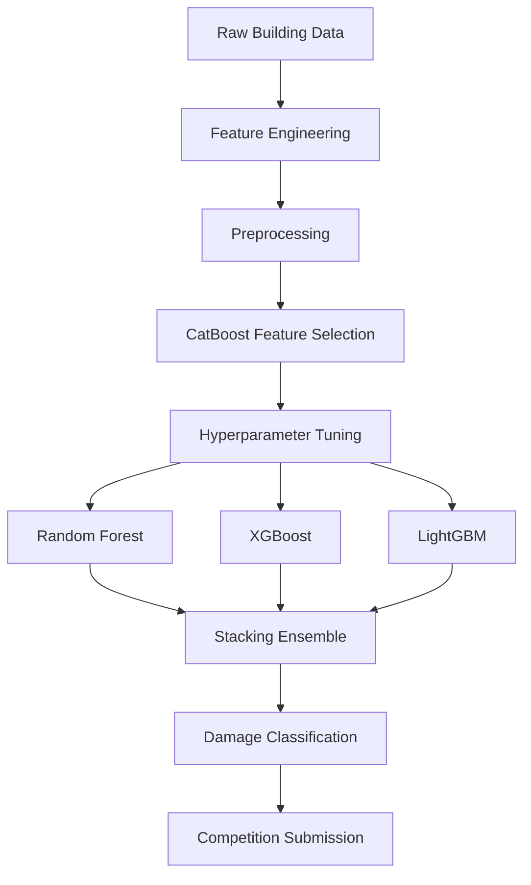

# Earthquake Damage Prediction

**Machine Learning | Ensemble Learning | Predictive Modelling**

Università Campus Bio-Medico di Roma  
Foundations of Artificial Intelligence — Final Project  
2026

## Overview

This project develops an end-to-end machine learning pipeline
for predicting structural damage to buildings affected by
the 2015 Nepal earthquake.

Based on the DrivenData competition *Richter's Predictor:
Modeling Earthquake Damage*, the task is formulated as a
multiclass classification problem using structural,
geographical and building-use information.

## Key Results

| Metric | Result |
|---|---:|
| Public leaderboard Micro-F1 | **0.7419** |
| Final configuration internal Micro-F1 | 0.7404 |
| Test set predictions | 86,868 |
| Target classes | 3 |
| Final model | Stacking Ensemble |

## Model Comparison

The following results refer to a common experimental
configuration without feature selection, PCA, sample
weighting or hyperparameter tuning.

| Model | Micro-F1 | Macro-F1 | Weighted-F1 |
|---|---:|---:|---:|
| XGBoost | 0.7419 | 0.6877 | 0.7360 |
| Stacking Ensemble | 0.7419 | 0.6883 | 0.7364 |
| Voting Ensemble | 0.7355 | 0.6739 | 0.7272 |
| LightGBM | 0.7276 | 0.6648 | 0.7196 |
| Random Forest | 0.7162 | 0.6457 | 0.7043 |

The final submission uses a separately configured
Stacking Ensemble with CatBoost-based feature selection
and hyperparameter tuning.

## System Architecture



## Prediction Task

The target variable, `damage_grade`, represents three
levels of structural damage:

| Class | Damage Level |
|---|---|
| 1 | Low |
| 2 | Medium |
| 3 | Severe |

Micro-F1 is the primary evaluation metric, consistently
with the competition scoring methodology.

## Methodology

- Exploratory data analysis and data quality assessment
- Structural and geographical feature engineering
- One-hot and frequency encoding
- Pipeline-integrated feature selection
- Baseline and advanced model comparison
- Randomized hyperparameter search
- Stacking ensemble learning
- Multiclass performance evaluation

Preprocessing and feature selection are integrated
into the modelling pipeline to mitigate data leakage
during validation.

PCA and sample weighting were investigated but were
not retained in the final configuration.

## Repository Structure

```text
├── main.py
├── requirements.txt
├── src/
│   ├── preprocessing/
│   ├── config.py
│   ├── data_loader.py
│   ├── features.py
│   ├── featureselector.py
│   ├── models.py
│   ├── evaluation.py
│   ├── hyperparameter_tuning.py
│   ├── pipeline_training_model.py
│   └── final_model.py
├── notebooks/
├── data/
├── outputs/
├── models/
└── docs/
```

Detailed methodological decisions are documented in
the [Decision Log](docs/decision_log.md).

Experimental results are available in
[Model Comparison](outputs/metrics/results_comparison.csv).

## Installation

```bash
python -m venv .venv
source .venv/bin/activate
python -m pip install -r requirements.txt
```

Place the original competition datasets in `data/raw/`.

On macOS, OpenMP may be required:

```bash
brew install libomp
```

## Execution

Compare candidate models:

```bash
python main.py compare-models
```

Evaluate the final configuration:

```bash
python main.py evaluate-final
```

Train the final pipeline:

```bash
python main.py train-final
```

Generate predictions:

```bash
python main.py make-submission --from-saved-model
```

## Research Limitations

Performance is evaluated within the competition's
dataset and evaluation framework.

The reported public leaderboard score does not establish
generalization to other earthquakes, geographical regions
or building populations.

The model is intended for academic research and is not
a substitute for professional structural assessment.

## Academic Context

**University:** Università Campus Bio-Medico di Roma  
**Course:** Foundations of Artificial Intelligence  
**Team:** Group 6

Developed collaboratively by Gianluca, Nicola, Mattia
and Claudia.

## License

See the [LICENSE](LICENSE) file for licensing information.
Dataset usage remains subject to the original
competition's terms.

---

*Academic machine learning project for research and
educational purposes.*
